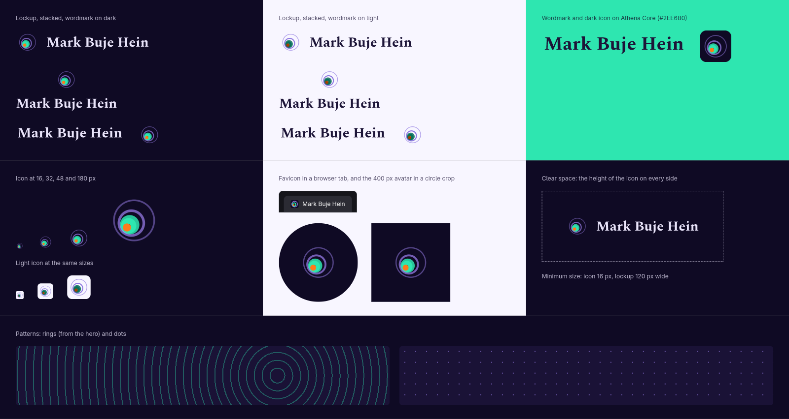

# markbujehein.github.io

Source for the personal academic website of **Mark Buje Hein**, published at
<https://markbujehein.github.io>. A static site built with [Astro](https://astro.build/) 7, TypeScript 7 and
Tailwind CSS 4, with Preact islands and view transitions.

The site presents a profile, news, a CV with PDF, and research and software projects.

## Credits

- Design: a hand-built site around the hero, with inspiration from the open-source Astro themes
  [Scholarly](https://github.com/jxpeng98/astro-theme-scholars) (MIT), [My Scholar](https://github.com/mychiffonn/myscholar)
  (Apache-2.0) and [Academic Pages Astro](https://github.com/arghyadipchak/academicpages-astro) (MIT).
  Notices are in [THIRD_PARTY_NOTICES.md](THIRD_PARTY_NOTICES.md).
- The previous Pelican site (a Jinja port of [al-folio](https://github.com/alshedivat/al-folio) by Vivek Bharadwaj, based on
  al-folio by Maruan Al-Shedivat and contributors) is kept in `_archive/pelican/`.

## Brand


| Role | Dark name | Dark | Light name | Light |
|---|---|---|---|---|
| Background | Iron Gall | `#0F0A24` | Sunlit Vellum | `#F8F6FF` |
| Surface | Midnight Codex | `#1A1236` | Illuminated Leaf | `#FFFFFF` |
| Text | Lunar Vellum | `#E9E4FA` (15.55:1) | Lampblack Ink | `#1D1538` (16.12:1) |
| Muted text | Marginalia | `#A79FC4` (7.71:1) | Silverpoint | `#5A5078` (6.88:1) |
| Primary (keywords) | Athena Core | `#2EE6B0` (11.99:1) | Oracle Core | `#08705A` (5.64:1) |
| Interaction (links, buttons) | Gravity Gun | `#FF7A1A` (7.39:1) | Spice Melange | `#A63F00` (5.89:1) |
| Interaction (hover, focus) | Arcane Torrent | `#A98BFF` (7.18:1) | Arcane Intellect | `#5636D1` (6.90:1) |

Contrast is against the background; every pair passes WCAG AA (4.5:1).

**Hero background: Tyrian Folio `#14092E`.** One colour for the hero panel in both dark and bright mode; not a page colour. Lunar Vellum on it is 15.29:1, Gravity Gun 7.26:1, Arcane Torrent 7.06:1.

### Shade steps

Each colour has one lighter and one darker step (OKLCH lightness ±0.07, same hue). Illuminated Leaf is white, so both of its steps are darker.

**Dark**

| Name | Lighter | Base | Darker |
|---|---|---|---|
| Iron Gall | `#1E1A36` | `#0F0A24` | `#040013` |
| Midnight Codex | `#2A2349` | `#1A1236` | `#0C0324` |
| Lunar Vellum | `#FCFBFF` | `#E9E4FA` | `#D2CDE3` |
| Marginalia | `#BDB5DB` | `#A79FC4` | `#928AAE` |
| Athena Core | `#53FEC6` | `#2EE6B0` | `#12CD9B` |
| Gravity Gun | `#FFA16E` | `#FF7A1A` | `#DF6A16` |
| Arcane Torrent | `#BCAAFC` | `#A98BFF` | `#9475E7` |

**Light**

| Name | Lighter | Base | Darker |
|---|---|---|---|
| Sunlit Vellum | `#FCFBFF` | `#F8F6FF` | `#E1DFE8` |
| Illuminated Leaf | `#F3F3F3` | `#FFFFFF` | `#E8E8E8` |
| Lampblack Ink | `#2D264B` | `#1D1538` | `#0E0526` |
| Silverpoint | `#6E648D` | `#5A5078` | `#473D63` |
| Oracle Core | `#2B856E` | `#08705A` | `#055A48` |
| Spice Melange | `#BE5522` | `#A63F00` | `#873201` |
| Arcane Intellect | `#684FE9` | `#5636D1` | `#4617B9` |

The lighter steps of Oracle Core (4.19:1) and Spice Melange (4.35:1) are below 4.5:1 on Sunlit Vellum: use them for fills and large text only.

| Use | Font |
|---|---|
| Headings | Spectral |
| Body | Inter |
| Math | KaTeX Computer Modern |
| Code | Monaspace Neon |

The image is rendered at 2× from [docs/brand/brand-sheet.html](docs/brand/brand-sheet.html).

### Logo



Mark: a source dot with rings drifting away from it, offset to one side (the source sits on a thirds point; ring radii step by the golden ratio). Files are in [docs/brand/logo/](docs/brand/logo/): `icon`, `lockup`, `stacked` and `wordmark` in `-dark` and `-light`, `favicon.svg` (thinnest rings dropped for 16 px), `avatar.svg`, and PNGs (`favicon-32`, `apple-touch-icon-180`, `icon-192`, `icon-512`, `avatar-400`). The wordmark is Spectral Bold converted to paths.

- Clear space: the height of the icon on every side.
- Minimum size: icon 16 px, lockup 120 px wide.
- Do not rotate, stretch or recolour; use the `-dark` file on dark backgrounds and `-light` on light ones.
- Patterns: concentric rings (hero) and a dot grid, in primary and lavender at low opacity.
- The site still uses its previous favicon (`public/favicon.svg`); the new files are not applied yet.

## Repository layout

| Path | Purpose |
|---|---|
| `src/` | The Astro site: pages, components, content collections, styles, utilities and their tests |
| `public/` | Static files (favicon, `pdf/cv.pdf`, exported notebooks in `notebooks/`) |
| `notebooks/` | marimo notebook sources; `pnpm run notebooks` exports them to `public/notebooks/` in system, light and dark themes (needs `uv`) |
| `tools/` | `import_site_data.py` (content import) and `check_output.py` (post-build checks) |
| `schema/` | JSON schema of the source export |
| `tests/` | Importer tests (pytest) |
| `docs/` | Content formats, design spec and plans |
| `_archive/pelican/` | The retired Pelican site, kept for reference |
| `.github/` | CI, deploy workflow, Dependabot, branch-protection ruleset |

## Development

Node and pnpm are pinned in `mise.toml` (`mise install`).

```bash
pnpm install
pnpm dev             # http://localhost:4321
pnpm run check       # astro sync + type check
pnpm test            # Vitest
pnpm run e2e         # Playwright end-to-end tests against the built site (CHROMIUM_PATH=/usr/bin/chromium to use a system browser)
pnpm run lint        # Oxlint
pnpm run format      # Oxfmt (src) + Prettier (.astro)
pnpm run build       # check + astro build into dist/
pnpm run check:output  # links, HTML, placeholder leaks in dist/
```

Importer tests: `pixi run test`.

## Content

Home, news, CV and projects live in `src/content/` and `src/data/cv.yml`. They are generated from the private source
repository by `tools/import_site_data.py` (run with `pixi run` and `--source site.yml`); hand-written project pages (`.mdx`)
are left alone. Format rules: [docs/CONTENT_FORMATS.md](docs/CONTENT_FORMATS.md). Inline math in Markdown is `$$…$$`.
The CV PDF in `public/pdf/cv.pdf` is not regenerated by the importer unless `--pdf` is passed.

## CI/CD

- **Pull requests** run `.github/workflows/ci.yml`: `lint` (Oxlint, Oxfmt/Prettier, ruff, yamllint) and `build`
  (type check, Vitest, Astro build, `check_output.py`, importer tests).
- **Pushes to `main`** run `.github/workflows/deploy.yml`: build, `check_output.py`, deploy with the GitHub Pages actions.
  It caches `node_modules/.astro/` for incremental builds. In the repository settings, **Pages > Source** is **GitHub Actions**.
- `.github/rulesets/default-branch.json` protects `main`: pull request required, `lint` and `build` must pass.

## Licence

Code follows the licences of the themes credited above. The personal content (text, CV, photos) is not intended for reuse.
